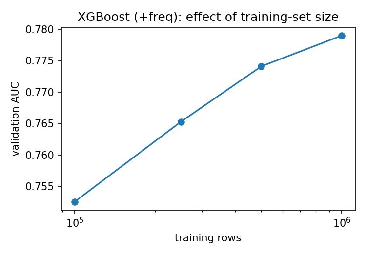
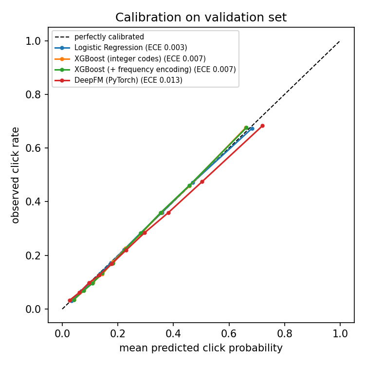
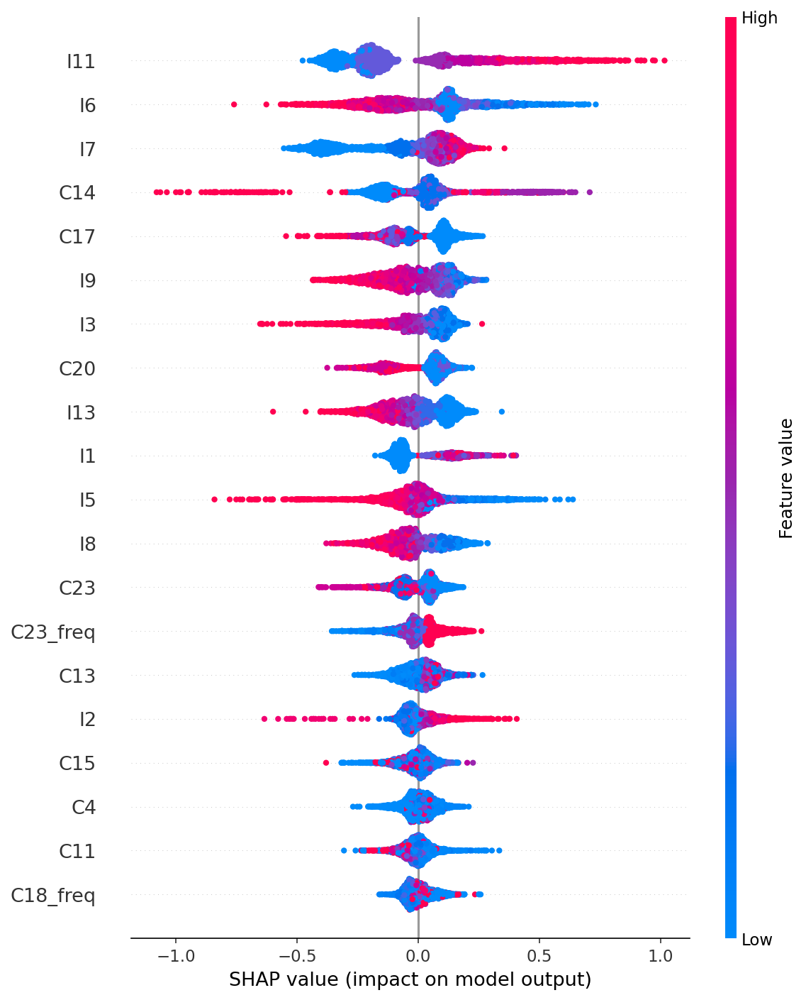

# Click-Through-Rate Prediction on Criteo Display Ads

Predict whether a user clicks a display ad (binary classification, ~25% positive rate) from 13 numeric and 26 hashed categorical features. The project compares a linear baseline, gradient-boosted trees and a **DeepFM** network implemented from scratch in PyTorch, with leakage-free preprocessing, a feature-engineering ablation, a training-set-size ablation, calibration analysis and SHAP.

## Results

Trained on **1M** Criteo impressions, evaluated on **250k** held-out validation impressions that are never used for fitting, tuning or model selection.

| Model | AUC | Log loss | ECE | Fit time (s) |
|---|---|---|---|---|
| Logistic Regression | 0.7809 | 0.4623 | **0.0029** | 45 |
| XGBoost (integer codes) | 0.7784 | 0.4640 | 0.0074 | 17 |
| XGBoost (+ frequency encoding) | 0.7790 | 0.4635 | 0.0071 | 28 |
| **DeepFM (PyTorch)** | **0.7852** | **0.4598** | 0.0135 | 84 |

Higher AUC and lower log loss are better. ECE (expected calibration error) measures how trustworthy the predicted probabilities are; lower is better. Fit times are from a CPU laptop.

### Training-set size ablation (XGBoost + frequency encoding)

| Training rows | AUC | Log loss |
|---|---|---|
| 100,000 | 0.7526 | 0.4848 |
| 250,000 | 0.7653 | 0.4737 |
| 500,000 | 0.7741 | 0.4670 |
| 1,000,000 | 0.7790 | 0.4635 |



### Calibration



### Feature importance (SHAP, XGBoost)



Computed on a random sample of 3,000 validation rows; colour is the feature value (for categorical features this is an integer category code, so colour is only loosely interpretable).

### Findings

- **DeepFM is the best model, but by a small margin:** +0.0043 AUC and -0.0025 log loss over logistic regression. On this feature set, a well-regularised linear model is a strong baseline.
- **Calibration trade-off:** logistic regression is the best calibrated (ECE 0.0029); DeepFM is the least (ECE 0.0135). The calibration plot shows DeepFM drifting below the diagonal at higher predicted probabilities: it overestimates click probability for the most likely clicks (roughly 0.72 predicted vs 0.68 observed in the top bin). Its ranking is better, but its probabilities would need post-hoc calibration (e.g. temperature scaling) before being used for anything like bid pricing.
- **XGBoost trails logistic regression slightly.** It was run with fixed, untuned hyperparameters, and integer-coded high-cardinality categories are a poor fit for trees, which may explain part of the gap.
- **Frequency encoding barely helps** (+0.0006 AUC). With a single seed this is within noise, so it should not be read as a real improvement.
- **More data keeps helping, with diminishing returns:** AUC rises from 0.7526 to 0.7790 as training rows grow 10x, but the last doubling (500k to 1M) added +0.0049 AUC versus +0.0088 for the one before. Training on more of the dataset would likely still help, with shrinking gains.
- **Feature importance (SHAP):** the most influential features for XGBoost are mostly numeric: `I11`, `I6` and `I7` lead, followed by categoricals `C14` and `C17`. Higher `I11` and `I7` push predictions toward a click, while higher `I6`, `I9` and `I3` push away from one. Two frequency-encoded features (`C23_freq`, `C18_freq`) reach the top 20, but most of the importance sits on the raw features, consistent with frequency encoding adding little. Criteo features are anonymised, so these cannot be interpreted semantically.

## Data

[Criteo_x4](https://huggingface.co/datasets/reczoo/Criteo_x4) (a standard split of the Criteo Kaggle Display Advertising Challenge data, ~45M rows). This repo reads the first **1M rows of `train.csv`** for training and the first **250k rows of `valid.csv`** for evaluation (configurable in `configs/default.yaml`). The 4 GB zip is downloaded automatically from Hugging Face on first run and is not stored in this repo.

Notable data properties: about 25% of impressions are clicks, and several columns are heavily missing (e.g. `I12` ~77% and `C22` ~76% missing in the training subset). Full statistics are written to `results/data_summary.json` on each run.

## Method

**Preprocessing (`src/data.py`)**
- Numeric: negatives clipped to 0, `log1p` to tame heavy tails, missing values set to 0.
- Categorical: mapped to integer codes. Categories seen fewer than 10 times in the *training* split become `other`; missing values get their own code; categories never seen in training also map to `other`.
- All vocabularies and thresholds are fitted on the training split only.

**Features (`src/features.py`)**
- Frequency encoding: each category is described by how common it is in the training data (fitted on train only).

**Models (`src/models/`)**
- Logistic regression on one-hot categories + standardised numerics.
- XGBoost with integer category codes, and the same model plus frequency-encoding features (this pair is the feature-engineering ablation).
- DeepFM: first-order terms + factorization-machine interactions + MLP over shared field embeddings. Epoch selection uses 10% of the *training* split, so the validation set stays untouched.

**Analysis (`src/evaluate.py`)**
- AUC, log loss, calibration curve and ECE, SHAP feature importance for XGBoost, and an AUC-vs-training-size ablation.

## Run it

```bash
pip install -r requirements.txt

python -m src.train --synthetic              # ~1 min smoke test with fake data, no download
python -m src.train                          # all models on real data (downloads ~4 GB once)
python -m src.train --model xgb_freq         # a single model
python -m src.train --rows 200000            # quicker run on a smaller subset
python -m src.train --scale-ablation         # AUC vs. number of training rows
pytest                                       # unit tests
```

A GPU speeds up DeepFM but is not required. Results are written to `results/` (`metrics.json`, `results.md`, plots).

## Layout

```
configs/default.yaml     rows, seed, hyperparameters
src/data.py              loading, cleaning, category encoding, synthetic data
src/features.py          frequency encoding, tree feature matrices
src/models/              logreg.py, xgb.py, deepfm.py
src/evaluate.py          metrics, calibration, SHAP, results table
src/train.py             CLI entry point
tests/                   unit tests (no-leakage checks, shapes, end-to-end smoke test)
results/                 metrics.json, results.md, plots
```

## Design notes and limitations

- **No leakage:** vocabularies, rare-category thresholds, scalers and frequency statistics come from training rows only; this is covered by unit tests.
- **Split:** Criteo_x4 is a *random* split of the original data, so rows are not time-ordered and a time-based split is not possible with this version. The original Kaggle `train.txt` is chronological, which would allow one.
- **Subset:** only a 1M-row subset is used by default; the scale ablation shows more data would help.
- **No hyperparameter tuning:** XGBoost, DeepFM and logistic regression use fixed settings. Logistic regression stopped at its 300-iteration limit before fully converging. Treat the comparison as a controlled baseline study, not a leaderboard attempt.
- **Single seed:** every number comes from one run; differences in the third decimal place of AUC are within noise.